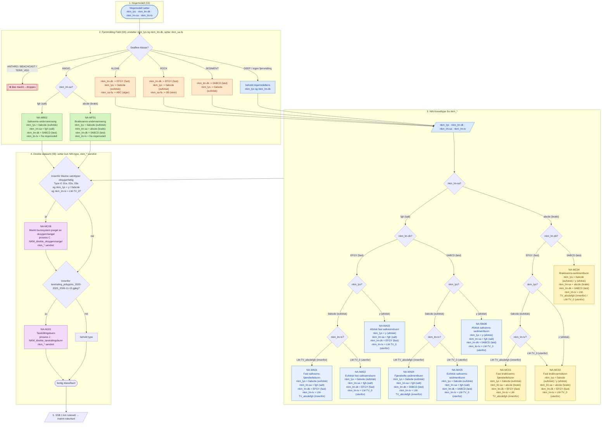

# Klassifiseringsregler – Marint Naturkart (NiN 3.0)

<!-- Generert av scripts/classify_rules_diagram.py fra mnk/rules.py – ikke rediger manuelt. -->

Rekkefølge (senere steg trumfer tidligere):

1. Nisjemodell (03)
2. Fjernmåling SeaBee (04)
3. Direkte: NA-MC08 Marint bunnsystem preget av oksygenmangel (05)
4. Direkte: NA-MJ01 Taretrålingsbunn (05)
5. Oppdeling i SSB 1 km rutenett → `marint-naturkart` (05)

Verdier på kantene er kodene i datasettets `nkm_*`-kolonner (forklaring i parentes).

Direkte datasett setter kun `nin_kode_fkid`/`NiN_name` (+ `nkm_prosess`, `metode_klassifisering`); `nkm_lys`, `nkm_lm-dk`, `nkm_lm-sa` og `nkm_lm-tv` endres ikke. nkm_* brukes kun som filter der regelen angir det.

## Samlet beslutningstre

| nin_kode_fkid | NiN_name | url | utvalg | filter nkm_* | metode_klassifisering |
|---|---|---|---|---|---|
| NA-MC08 | Marint bunnsystem preget av oksygenmangel | `gs://niva-geodata/MarintNaturKart/input/mdir/NyTypologi2022.geo.parquet` | `Type` ∈ 01a, 02a, 03a | `nkm_lys` ∈ y, 0abcde; `nkm_lm-tv` ∈ LM-TV_0 | `NKM_direkte_oksygenmangel` |
| NA-MJ01 | Taretrålingsbunn | `gs://niva-geodata/MarintNaturKart/input/niva/taretraling_polygons_2020-2025_2026-11-15.gpkg` | alle | alle | `NKM_direkte_taretralingsbunn` |
